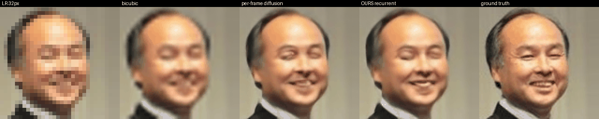

# PixelStream-SR

**VAE-free, one-step, real-time face video super-resolution with a clean-pixel-prediction Diffusion Transformer.**

<p align="center">
  
  <br><em>32→128 px, 1 network pass per frame, Colab T4. Left to right: LR input · bicubic · per-frame diffusion (flickers) · ours (shared-noise) · ground truth</em>
</p>

## TL;DR

Most video diffusion models run inside a VAE latent space. The VAE adds decode latency and smears the details that matter for faces (teeth, eyelashes, skin). PixelStream-SR is a **28M-parameter Diffusion Transformer that works directly on pixels**:

* **Clean-pixel prediction (x-prediction) flow matching** on the HR − bicubic residual with 8×8 pixel patches → **one Euler step is already sharp**.
* **Representation alignment in pixel space**: a mid-layer of the DiT is aligned to frozen DINOv2 tokens during training (zero inference cost).
* **Shared-noise streaming**: reusing one noise seed across frames removes most diffusion flicker for free.

| | PSNR↑ | SSIM↑ | LPIPS↓ | ms / frame (T4) |
|---|---|---|---|---|
| bicubic ×4 | 26.26 | 0.806 | 0.318 | – |
| **ours, 1 step** | **28.05** | **0.860** | 0.111 | **13–19** |
| ours, 2 steps | 27.56 | 0.849 | 0.092 | 36.2 |
| ours, 4 steps | 26.97 | 0.835 | 0.076 | 74.5 |
| ours, 8 steps | 26.55 | 0.823 | **0.067** | 113.4 |

256 held-out CelebA faces, 32→128 px; latency = batch-1 wall-clock on a Colab T4 (fp16), range over two runs of the same network. One network gives two modes: **1 step = regression-like (highest PSNR, real-time)**, **8 steps = generative (lowest LPIPS)** — the perception–distortion trade-off controlled by step count alone.

## Video: flicker and drift

Synthetic camera motion on held-out faces (known warps ⇒ exact temporal-consistency metric: un-warp every frame and measure |frame_t − frame_{t−1}|, 8-bit units, lower is better).

| 1 step / frame, 32-frame clips | flicker↓ | PSNR↑ |
|---|---|---|
| per-frame diffusion (independent noise) | 4.77 | 28.43 |
| **shared noise (ours)** | **3.71** | **28.13** |
| recurrent + shared noise | 2.78 | 27.50 |
| bicubic (floor set by LR aliasing) | 2.55 | 26.75 |

| 1 step / frame, 96-frame clips | flicker↓ | PSNR↑ | PSNR first 8 → last 8 frames |
|---|---|---|---|
| **shared noise (ours)** | **1.43** | **28.13** | −0.42 (clip difficulty, no memory) |
| recurrent + shared noise | 2.71 | 23.61 | **−3.55 (drift)** |
| recurrent, anchored memory | 1.65 | 27.30 | −0.54 |

**Findings.** Shared noise is the right temporal mechanism for few-step pixel diffusion: large flicker reduction, no state, no drift. Self-conditioning on the model's own previous output (trained with perfect previous frames) helps only under fast motion and **drifts over long clips** (−3.5 dB / 96 frames; −6 dB with 4 stochastic steps). Anchoring the memory to a history-free estimate removes the drift but not the gap. A warm start from the previous output (SDEdit-style) collapses within 32 frames (PSNR 16): with x-prediction the network trusts its input at low noise, so errors compound. The principled fix — training the recurrence on the model's own outputs — is left as future work.

## Method in one paragraph

Input: LR frame bicubic-upsampled to 128 px (3 ch) + optional previous output (3 ch) + validity mask (1 ch), concatenated with the noisy residual x_t (3 ch) and linearly patchified (8×8 → 256 tokens). Backbone: 10 DiT blocks, width 384, adaLN-Zero timestep conditioning, RMSNorm, QK-norm, 2-D sincos positions. Target: x₀ = 3·(HR − bicubic). Path: x_t = (1−t)·x₀ + t·ε with logit-normal t; loss = MSE on x̂₀ + 0.5·(1 − cos) between block-4 tokens and DINOv2-S/14 patch tokens of the HR frame. Sampler: x_{t'} = x̂₀ + (t'/t)(x_t − x̂₀); with t'=0 one step returns x̂₀ directly. Training: 10k steps, batch 48, AdamW 2.5e-4, EMA 0.9995, fp16, ~70 min on a free Colab T4, 16k CelebA images with random blur/noise degradation.

## Reproduce

1. Open `PixelStream_SR_colab.ipynb` in Google Colab (File → Upload notebook).
2. Runtime → Change runtime type → GPU.
3. Runtime → Run all. Allow Google Drive access when asked (checkpoints survive disconnects).
4. ~1 h 15 min later: `summary.md`, `qualitative.png`, `demo_1step.mp4/.gif`, `demo_4step.mp4/.gif`, `results.json`, `video_results.json` are in `MyDrive/pixelstream_final/`.
5. Optional: cell 11 super-resolves a face video you upload (1 step + shared noise); cell 13 reproduces the 96-frame drift analysis.
6. Re-running the notebook does not retrain: cell 7 finds the finished checkpoint and skips straight to evaluation (~8 min).

Ablations are flags in cell 2: `USE_REPA`, `PREV_KEEP_P`, `PREV_MOTION`, `RES_SCALE`, `DEGRADE`, `PATCH`; the step count and noise policy are arguments of `sample` / `stream_sr`.

## Representation-alignment ablation

Same recipe, `USE_REPA = False` (10k steps, T4):

| | PSNR 1-step | SSIM 1-step | LPIPS 1-step | LPIPS 2-step | LPIPS 4-step | LPIPS 8-step |
|---|---|---|---|---|---|---|
| with REPA (final model) | 28.05 | 0.860 | **0.111** | **0.092** | **0.076** | **0.067** |
| without REPA | 28.03 | 0.859 | 0.114 | 0.098 | 0.082 | 0.072 |

PSNR/SSIM are unchanged; LPIPS is consistently better with alignment at every step count (≈6–7 % relative at 2–8 steps). The effect is real but small: in a strongly conditioned task like SR the LR input already carries the structure a latent (or DINO) would supply, so alignment mainly improves the stochastic texture. We expect a larger effect for weakly conditioned generation and at higher resolution. Training cost: one frozen DINOv2-S forward per batch (~20 % slower); zero cost at inference (the alignment head is dropped). Video results with shared noise are identical across the two runs (3.63 / 28.16 vs 3.71 / 28.13).

## Layout

```
PixelStream_SR_colab.ipynb   the whole project (data → model → training → evaluation → video demo → drift analysis)
results/                  summary.md, results.json, video_results.json, qualitative.png, demo_1step.gif, demo_4step.gif
```

## Related work

x-prediction pixel DiTs (JiT, 2025); representation alignment for diffusion transformers (REPA, 2024); frame-recurrent video SR (FRVSR, 2018); shared-noise streaming diffusion (StreamDiffusion, 2023); perception–distortion trade-off (Blau & Michaeli, 2018). ECCV 2026 context: Hi-DiT (hybrid latent–pixel DiT), AVSR-Diff, pixel-space diffusion depth estimation, DuoFlow / AnyFlow (few-step flow models).

## Limitations and next steps

128 px, faces only, synthetic motion for the video metric; recurrence needs training on own outputs; scale to 256 px (patch 16, same token count), real talking-head video (HDTF / CelebV-HQ), a latent-DiT baseline of equal size, and an audio / lip-mask condition to turn the same model into a VAE-free lip-sync editor.

## License

MIT. CelebA is used under its research-only terms; the released weights are for research use.
